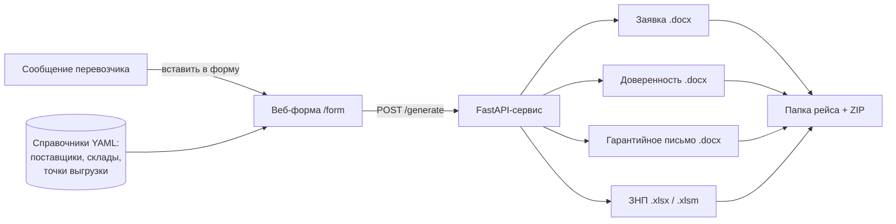

# Transport Docs Generator

Веб-сервис, который по данным одного рейса автоматически собирает **пакет документов на перевозку груза**: заявку перевозчику, доверенность на водителя, гарантийное письмо и заполненный Excel-бланк заказа поставщика.


> Все данные в репозитории **вымышленные**: компания «Ромашка», поставщики «Альфа», «Бета», «Гамма», «Дельта», водители, телефоны и реквизиты. Реальные документы заказчика в репозиторий не входят.

## Содержание

- [Зачем это нужно](#зачем-это-нужно)
- [Как это работает](#как-это-работает)
- [Возможности](#возможности)
- [Быстрый старт](#быстрый-старт)
- [Пример запроса](#пример-запроса)
- [Настройка без программирования](#настройка-без-программирования)
- [API](#api)
- [Переменные окружения](#переменные-окружения)
- [Структура проекта](#структура-проекта)
- [Развёртывание](#развёртывание)

## Зачем это нужно

Оптовая компания закупает металлопрокат на заводах в России и возит его фурами в Беларусь. На **каждый рейс** нужно подготовить от двух до четырёх документов:

| Документ | Формат | Когда нужен |
|---|---|---|
| Заявка на транспортную перевозку | Word | всегда |
| Доверенность на водителя (форма М-2) | Word | если поставщик не работает по своему бланку заказа |
| Гарантийное письмо | Word | если поставщик его требует |
| «Заказ на поставку» (ЗНП) — бланк поставщика | Excel | если поставщик работает по своему бланку |

Раньше менеджер заполнял всё это вручную, перенося данные из сообщения перевозчика: ФИО и паспорт водителя, номера машины и прицепа, адреса складов, контакты. Одни и те же данные приходилось вписывать в несколько документов, а ошибка в паспорте или номере машины означала, что водителя не пустят на склад.

Сервис делает так, чтобы данные вводились **один раз**, а все документы рейса собирались автоматически и одинаково.

## Как это работает



1. **Менеджер открывает форму** и выбирает поставщика, склад погрузки, перевозчика и точку выгрузки из выпадающих списков.
2. **Вставляет сообщение перевозчика как есть**, например:
   ```
   Авто: Даф АА 0003-7
   Прицеп: Шмитц АБ 0003-7
   Водитель: Кузнецов Кирилл Кириллович
   Паспорт: НВ 0000003 выдан Ленинским РОВД г.Минска 02.05.2024
   Тел.: +375 29 0000003 / +7 900 0000003
   ```
   Кнопка «Разобрать» раскладывает его по полям формы. Менеджер только проверяет.
3. **Сервис определяет состав пакета** по справочнику поставщиков: заявка — всегда, а дальше доверенность, ЗНП или гарантийное письмо — в зависимости от поставщика.
4. **Собирает документы** из шаблонов и кладёт их в отдельную папку рейса. Файлы можно скачать по одному или одним ZIP-архивом.
5. **Возвращает предупреждения**, если что-то выглядит подозрительно: необычный номер паспорта, нет телефона, масса вне диапазона 0–25 т. Документы при этом всё равно формируются — решение остаётся за человеком.

## Возможности

### Заполнение чужого Excel-бланка без меток
Поставщик присылает свой бланк «Заказ на поставку» на каждый заказ, и количество строк продукции в нём каждый раз разное. Поэтому ячейки нельзя искать по фиксированному адресу.

Сервис находит нужную ячейку по двум признакам: **подписи строки в колонке A** и **жёлтой заливке** поля ввода. Правила описаны в [`input_dir/ЗНП_карта_полей.yaml`](input_dir/ЗНП_карта_полей.yaml):

```yaml
- id: fio_voditelya
  anchor: "Ф.И.О. лица, который будет принимать груз"   # подпись в колонке A
  pick: first                                           # первая жёлтая ячейка строки
  istochnik: "voditel.fio"                              # откуда взять значение
```

Если поставщик поменяет бланк, достаточно поправить YAML, код трогать не нужно. Макросы в присланном `.xlsm` сохраняются.

### Состав пакета задаётся справочником, а не кодом
У каждого поставщика в справочнике указан тип складского документа:

| `skladskoy_dokument` | Что в пакете |
|---|---|
| `znp` | заявка + заполненный бланк ЗНП |
| `garant` | заявка + доверенность + гарантийное письмо |
| `net` | заявка + доверенность |

Нового поставщика можно добавить строкой в YAML. Если поставщика нет в справочнике, его реквизиты можно ввести вручную прямо в форме.

### Подпись и печать
По галочке в форме (с подтверждением) поверх линий подписи накладываются картинки подписи руководителя, главного бухгалтера и печати. Картинки плавающие: шаблон документа не ломается, а прочерки для подписи остаются на месте.

### Нумерация документов
- Исходящие номера заявок и писем в формате `ДДММ/N` — дата и порядковый номер за день.
- Сквозной счётчик доверенностей `N-Д`.
- Форма заранее подставляет следующий номер, но его можно поправить вручную. Счётчик подстраивается под больший номер, поэтому номера не повторяются.
- Номер доверенности одинаковый во всех документах пакета.

### Мелочи, которые экономят время
- **Количество прописью** для доверенности считается само («Двадцать», «Пятнадцать»).
- **Срок действия доверенности** — дата выдачи плюс 10 дней.
- **Значения по умолчанию** для типового груза: наименование, упаковка, условия оплаты.
- **Адрес и контакт точки выгрузки** подтягиваются из справочника по названию.
- **Несколько складов погрузки** и до двух точек выгрузки в одном рейсе.
- **Спецификация к сделке** (любой файл) кладётся в папку рейса, её номер печатается в доверенности.

### Безопасность
- Скачивание файлов и сохранение загрузок защищены от обхода путей (path traversal): файл нельзя прочитать или записать за пределами рабочих папок.
- Изображения подписи и печати хранятся вне репозитория (`assets_private/` в `.gitignore`).

### Запуск для неподготовленных пользователей
Сервис собирается в `.exe` через PyInstaller: менеджер запускает его двойным щелчком, и браузер сам открывается на форме. Повторный запуск не создаёт второй сервер, а просто открывает форму. Шаблоны и справочники лежат рядом с `.exe` и правятся без пересборки.

## Быстрый старт

Нужен Python 3.10 или новее.

```bash
git clone https://github.com/bachaa7/transport-docs-generator.git
cd transport-docs-generator

python -m venv .venv
.venv\Scripts\activate            # Linux / macOS: source .venv/bin/activate
pip install -r requirements.txt

python config.py                  # проверка: все шаблоны и справочники на месте
python test_trips.py              # сквозной тест: два рейса и один ошибочный запрос
python main.py                    # сервис на http://127.0.0.1:8077, форма откроется сама
```

Готовые документы появятся в папке `output/`.

Чтобы проверить наложение подписи и печати, положите любые PNG-картинки в папку `assets_private/` с именами `podpis_ruk.png`, `podpis_buh.png`, `pechat.png` и отметьте в форме галочку «Проставить подпись и печать».

## Пример запроса

Тот же запрос, что отправляет форма, можно послать напрямую:

```bash
curl -X POST http://127.0.0.1:8077/generate \
  -H "Content-Type: application/json" \
  -d '{
    "postavshchik": "beta",
    "sklady": ["Заречный"],
    "perevozchik": "ЧУП «Быстрый груз»",
    "data_zagruzki": "18.06.2026 г",
    "zayavka_nomer": "1806/1",
    "voditel": {
      "fio": "Сидоров Сидор Сидорович",
      "pasport_seria": "МР", "pasport_nomer": "0000002",
      "pasport_vydan": "Ленинским РУВД г. Минска", "pasport_data": "17.05.2015",
      "avto": "MAN TGX АВ 0002-7", "pricep": "SCHMITZ АБ 0002-7",
      "tel_by": "+375 29 000-00-32"
    },
    "vygruzka": [{"nazvanie": "ООО «Стройпарк»", "gruz": "труба"}],
    "gruz": {"massa": "15 тн", "stoimost": "1 500 000"},
    "dover_nomer": "300-Д", "dover_data": "2026-06-18",
    "prilozheniya": [{"nomer": "000101", "data": "08.06.2026 г."}]
  }'
```

Ответ:

```json
{
  "ok": true,
  "postavshchik": "ООО «Бета Трубный завод»",
  "session": "BETA_1806_1_2026-06-18_101500",
  "sostav_paketa": ["zayavka", "doverennost", "pismo"],
  "dokumenty": [
    {"tip": "zayavka", "fail": "zayavka_1806_1.docx", "...": "..."},
    {"tip": "doverennost", "fail": "doverennost_1806_1.docx", "...": "..."},
    {"tip": "pismo", "fail": "pismo_1806_1.docx", "...": "..."}
  ],
  "predupezhdeniya": []
}
```

Адрес и контакт «ООО «Стройпарк»» сервис подставил сам из справочника точек выгрузки.

## Настройка без программирования

Всё, что меняется в работе компании, вынесено из кода в папку `input_dir/`:

| Файл | Что в нём |
|---|---|
| `spravochnik_postavshchiki.yaml` | поставщики: название, договор, тип складского документа |
| `spravochnik_sklady_pogruzki.yaml` | склады погрузки каждого поставщика: адрес, контакт, режим работы |
| `spravochnik_tochki_vygruzki.yaml` | частые точки выгрузки: свои склады и клиенты |
| `spravochnik_perevozchiki.yaml` | перевозчики для выпадающего списка |
| `ЗНП_карта_полей.yaml` | как найти и чем заполнить поля бланка поставщика |
| `ШАБЛОН_*.docx` | шаблоны Word с полями `{{ ... }}` (Jinja2) |
| `ШАБЛОН_ЗНП_пустой.xlsx` | запасной бланк ЗНП, если поставщик не прислал свой |

Справочники устроены так, чтобы их можно было заменить выгрузкой из 1С.

## API

| Метод | Путь | Назначение |
|---|---|---|
| `GET` | `/` | проверка работы сервиса и список поставщиков |
| `GET` | `/form` | веб-форма |
| `GET` | `/spravochniki` | справочники для формы |
| `POST` | `/parse_voditel` | разобрать сообщение перевозчика на поля |
| `GET` | `/next_nomer` | следующие свободные номера документов |
| `POST` | `/upload_znp` | загрузить бланк заказа поставщика |
| `POST` | `/upload_spec` | загрузить спецификацию к сделке |
| `POST` | `/generate` | сформировать пакет документов |
| `GET` | `/files/{session}/{name}` | скачать один документ |
| `GET` | `/zip/{session}` | скачать весь пакет одним ZIP |

Интерактивная документация (Swagger): `http://127.0.0.1:8077/docs`.

## Переменные окружения

Все необязательные — по умолчанию папки создаются рядом с программой.

| Переменная | По умолчанию | Назначение |
|---|---|---|
| `INPUT_DIR` | `./input_dir` | шаблоны и справочники |
| `OUTPUT_DIR` | `./output` | готовые пакеты документов |
| `UPLOAD_DIR` | `./input_dir/upload_znp` | загруженные бланки и спецификации |
| `DATA_DIR` | `./data` | счётчики номеров |
| `ASSETS_DIR` | `./assets_private` | подпись и печать |
| `GENERATE_URL` | `/generate` | куда форма отправляет данные (например, на webhook n8n) |

PDF-копии документов через LibreOffice отключены по умолчанию и включаются флагом `ENABLE_PDF` в `config.py`.

## Структура проекта

```
main.py            FastAPI: эндпоинты, состав пакета, наложение подписей
schemas.py         модели запроса (Pydantic)
context.py         подготовка данных для шаблонов, значения по умолчанию
generators.py      Word (docxtpl), Excel (openpyxl, поиск ячеек по карте полей), PDF
parser.py          разбор сообщения перевозчика
validators.py      проверки, которые возвращают предупреждения, а не ошибки
numbering.py       исходящие номера и счётчик доверенностей
propis.py          числа прописью
references.py      загрузка справочников
config.py          пути, константы, значения по умолчанию
form.html          веб-форма (HTML + JavaScript без фреймворков)
test_trips.py      сквозной тест
input_dir/         шаблоны, бланк ЗНП, справочники, карта полей
n8n/               workflow для n8n (необязательно)
doc_generator.spec сборка .exe через PyInstaller
```

## Развёртывание

- **Linux-сервер** (uvicorn, Docker + n8n): [DEPLOY_LINUX.md](DEPLOY_LINUX.md)
- **Windows `.exe`** для менеджеров: [СБОРКА_EXE.md](СБОРКА_EXE.md)
